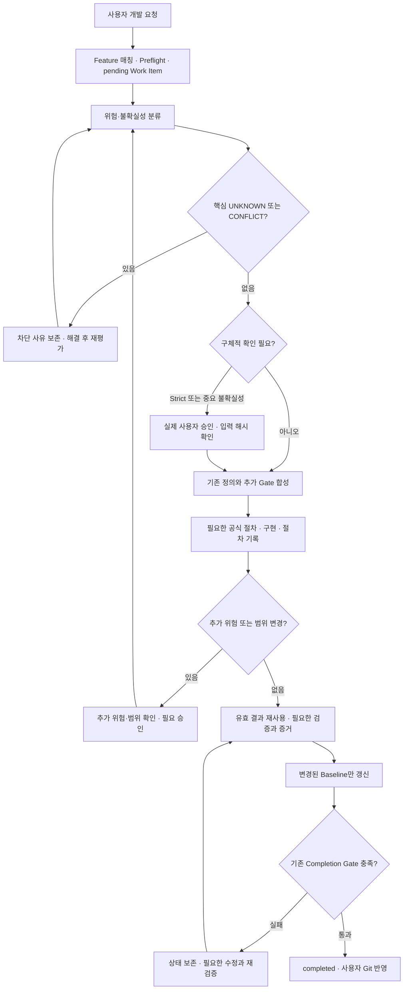

# 위험도 기반 개발·검증 프로파일

설계 2.0 · Core 0.6.0. 개발 요청의 계약 위험과 영향 범위에 비례해 절차를 선택한다. 이 문서는 프로파일·재사용 정의·일반 진행과 예외 승인의 원본이다. 실제 Gate 실행·Fingerprint·완료 판정은 [검증 계약](06-verification.md), 상태는 [Work Item 생명주기](04-artifact-lifecycle.md)를 따른다. 별도 검증 엔진·오케스트레이터·상태 DB를 만들지 않는다.

## 책임과 입력

Skill은 사용자 요청, 현재 명세·계획·태스크, 실제 코드·계약, 기존 의존성·분석과 검증 방법으로 의미적 위험을 분류한다. Core는 제출된 사실의 구조, 최소 프로파일, 단계 의무·필수 정의 누락, 승인 경로와 현재 증거를 검사한다. Core가 소스를 의미 분석하거나 Skill의 판단이 사실임을 증명하는 것은 아니다. 파일 수·패치 크기·작업 이름만으로 경량을 선택하지 않는다. 이전 분석의 입력과 적용 범위가 유효하면 다시 전체 분석을 수행하지 않는다.

입력은 개발 요청·확정 Feature·현재 Baseline·검증 정의·영향 소견이다. 출력은 같은 Work Item의 프로파일 분류/확장 이력, 수행한 공식 절차 기록, Gate 정의 스냅샷·실행 이력과 기존 완료 결과다. 공식 산출물 형식과 `sdd-develop` 진입점은 유지한다. Codex·Claude Code는 같은 공통 Skill 정책을 사용한다.

## 프로파일 분류

| 프로파일 | 적용 기준 | 대표 후보와 주의 |
| --- | --- | --- |
| Lightweight | 기존 계약 유지, 명확한 국소 영향, 중요 불확실성 없음 | UI 문구·스타일, 로그 메시지, 국소 리팩터링·결함 수정, 계약에 영향 없는 설정. 인증 UI처럼 보이더라도 실제 인가 계약이 변하면 Strict다. |
| Standard | 일반 기능 추가·확장, 계약·관련 Feature 영향, 비파괴적 구조 변경 | 신규 Feature·API·관련 의존 변경. 범위 이름만으로 판단하지 않고 실제 계약과 영향 근거를 남긴다. |
| Strict | 중요 계약·보안·데이터·시스템 안정성 영향 | 외부 API 파괴, DB 마이그레이션, 인증·인가, 보안, 트랜잭션·동시성, 중요 아키텍처, 광범위 의존성 변경. 최초 분류·상향·새 고위험 사실은 구체적 확인을 받는다. |

`profile ID PLAN.json`의 risks는 다음 boolean 항목을 모두 가진다.

- Strict 최소: breaking_api, migration, auth, security, transactions, architecture, broad_dependencies.
- Standard 최소: new_feature, contract_changed, cross_feature, schema_change.
- 모든 항목이 false이면 Lightweight 후보다. Work Item에 여러 Feature가 선언되면 Core도 cross_feature를 반영한다. 상위 프로파일 선택은 가능하며 현재 위험의 최소보다 낮은 선택은 거부한다.

새 위험은 추가 검증 또는 상향으로 반영한다. 같은 Work Item에서 한 번 확인한 true 위험과 필수 절차는 제거하지 않는다. 기존 필수 검증 회피를 위한 하향을 허용하지 않는다. 중요 판단 불확실성은 uncertain=true로 확인 대상으로 삼되, findings의 핵심 UNKNOWN/CONFLICT는 기존 규칙대로 차단한다. Strict나 사용자 동의만으로 차단 소견이 해소되지 않는다.

## 최소 절차와 동적 추가

| 절차 | Lightweight | Standard | Strict |
| --- | --- | --- | --- |
| Preflight·Feature 매칭·Work Item | 필수 | 필수 | 필수 |
| Discovery | 새 경계/현행 이해 등 조건에 해당할 때 | 신규 Feature 등 조건에 해당할 때 | 조건에 해당할 때 |
| Specify | 의도·명세 변경 필요 시 | 신규/계약/명세 변경 시 | 변경 필요 시 |
| Clarify | 실제 모호성이 있을 때 | 필요 시 | 필요 시 |
| Plan | 유효한 기존 계획 활용 | 기존 계획 검토, 변경 시 공식 개정 | 필수 검토 |
| Checklist | 기본 제외, 기존 필수 정책은 유지 | 필요 시 | 적용 여부 필수 검토 |
| Tasks | 변경 작업 중심, 공식 형식·전제 유지 | 정식 수행 | 정식 수행 |
| Analyze | 기본 제외 | 필요 시 | 적용 여부 필수 검토 |
| Implement | 필수 | 필수 | 필수 |
| Converge | 기본 제외 | 필요 시 | 적용 여부 필수 검토 |
| 영향 분석·테스트 | 국소 계약·변경 중심 | 관련 의존·회귀 | 전이 의존·확대 검증 |
| Baseline·Evidence | 변경분·간결한 의미 근거 | 변경분·표준 근거 | 영향 범위의 변경 관리정보·상세 근거 |
| Completion Gate | 공통 완료 조건 | 공통 완료 조건 | 공통 완료 조건 |

Core의 기본 필수 공식 절차 기록은 plan/tasks/implement다. Plan은 변경 필요가 없으면 유효한 현재 계획의 검토·재사용으로 기록한다. new_feature는 discovery/specify를, contract_changed 또는 conditions.spec_changed는 specify를 추가한다. conditions.clarify/discovery도 해당 의무를 추가한다. Strict에는 checklist/analyze/converge 각각의 considerations.required와 구체적 reason이 필요하며 true인 절차를 필수로 추가한다. additional_steps 또는 필수 Gate의 official_step도 의무를 추가한다. 프로젝트 정책상 필요한 절차를 기본 제외로 취소할 수 없다.

Discovery는 기존 READY·등록·분리/통합 보존 검증을 재사용한다. 새 Feature는 공식 spec·plan과 READY, 영구 UUID 등록, 현재 분석 근거를 갖춘 뒤 개발한다. 초기화에서 수행한 검토를 근거 없이 재실행하지 않는다. 기존 Feature는 공식 개정 흐름을 사용하며 생성 템플릿으로 기존 파일을 덮어쓰지 않는다.

[Spec Kit 1.4.0 계약](spec-kit-integration.md)을 유지한다. Implement는 공식 tasks 전제와 존재하는 체크리스트의 읽기 전용 검사를 수행한다. 경량이라고 체크리스트를 지우거나 표시를 임의 변경하지 않는다. Analyze는 완성된 tasks 이후의 읽기 전용 산출물 일관성 검토다. Converge는 tasks·implement 이후의 구현 충족 검토이며 필요한 조치만 tasks에 append한다. 서로 목적이 다르므로 통합·대체하지 않는다. 공식 절차가 요구하는 별도 사용자 판단·필수 확장 훅은 그대로 적용한다.

## verification.yaml

Baseline의 일곱 번째 파일은 재사용 가능한 검증 **정의**만 관리한다. 기존 테스트·빌드·CI 파일을 복제하지 않고 실제 명령·방법과 입력·증거를 참조한다. features.yaml은 Feature/관계, source-map.yaml은 소스 연결, work-items.yaml은 해당 요청의 실제 정의 스냅샷·결과·이력이다.

| 필드 | 계약 |
| --- | --- |
| schema_version | 정수 1. Features 스키마·Core 배포와 독립적인 이 파일의 구조 식별자 |
| status | unconfigured 또는 configured. 전자는 방법 미확인이며 개발 검증 통과를 뜻하지 않음 |
| reason·basis | 정의 확인 근거와 현재 로컬 증거 ref 배열. configured에는 실제 비어 있지 않은 근거 필요 |
| project.gates | 프로젝트 공통 Gate 템플릿 배열 |
| features.UUID.gates | 등록된 Feature별 템플릿 배열. 폐기 Feature 정의도 보존하되 현재 선택에서 제외 |
| Gate 공통 필드 | id/rationale/required/required_for/targets/paths/evidence/evidence_requirement와 kind=command의 argv 또는 kind=review의 method. [실행 계약](06-verification.md)을 재사용 |
| profiles | 적용할 lightweight/standard/strict의 비어 있지 않은 배열 |
| mandatory | true이면 profiles 필터와 무관하게 모든 프로파일에 적용. required도 true여야 함 |
| targets | 프로젝트는 `$scope` 또는 등록 UUID 배열. Feature 템플릿은 `$scope` 또는 자기 UUID 배열. 합성 시 실제 Work Item 범위로 확정 |
| purpose | 선택적 검증 목적 식별자. 생략 시 Gate ID. 동일 파일·명령만으로 서로 다른 목적을 합치지 않음 |
| official_step | 공식 결과를 사용하는 review Gate의 구체적 절차 이름. 서로 다른 공식 목적을 구분하며 해당 절차 기록도 필수 |
| evidence의 `$execution` | command 전용. `docs/sdd/evidence/WORK_UUID/GATE_ID.log`로 합성하여 Core가 실제 실행 로그를 보존. 기존 보고서를 지정해도 됨 |

다음은 실제 필드가 있는 예시다. 경로·명령은 프로젝트의 실제 검사와 승인한 검증 계획에서 정하며 예시를 발견한 검사로 가장하지 않는다.

```yaml
schema_version: 1
status: configured
reason: 기존 프로젝트 테스트 규칙과 관련 입력을 확인
basis: [verification-rules.md]
project:
  gates:
    - id: project-tests
      purpose: project.behavior
      rationale: 변경 요청의 기존 동작 계약과 회귀 확인
      profiles: [lightweight, standard, strict]
      mandatory: true
      required: true
      required_for: [complete]
      targets: $scope
      paths: [app.py, tests/test_app.py]
      evidence: [$execution]
      evidence_requirement: 실제 테스트 실행 결과와 종료 코드
      kind: command
      command: [python, -m, unittest, discover, -s, tests]
features: {}
```

초기 설치·구버전 변환은 빈 unconfigured만 생성한다. sdd-init은 실제 검증 방법을 조사해 정의를 등록한다. 초기/추가 정의는 Core가 허용하는 자동 경로로 적용하며 기존 정의의 삭제·변경 또는 검토된 빈 공통 정책은 구체적 승인이 필요하다. Greenfield에서 아직 공통 검사가 없다면 확인하지 않은 명령을 발명하지 않는다. 새 Feature의 승인된 계획에서 필요한 실제 검증 방법을 마련하거나, 공통 정의 부재를 명시적으로 확인한 뒤 Work Item별 필수 Gate로 검증한다. 어느 경우든 적용 필수 Gate가 없는 Work Item은 진행할 수 없다.

sdd-develop은 공통+대상 Feature+현재 요청의 추가 Gate를 합성한다. 같은 ID가 완전히 동일하면 정의 하나와 여러 출처를 보존하고, 같은 ID의 정의가 다르면 차단한다. 필수 템플릿 누락·변경은 수동 승인 해시를 주더라도 거부하며 먼저 정책 변경의 구체적 절차를 거쳐야 한다. 현재 정책 변경은 기존 Work Item 스냅샷을 소급 재작성하지 않지만 열린 작업이 이전 정책으로 진행하는 것은 차단하고 재합성을 요구한다.

신규 Feature·검증 방법 변경은 해당 정의만 갱신한다. 폐기 정의와 과거 Work Item 참조는 보존한다. 공통 Gate가 폐기 경로를 참조한다면 기존 Feature 폐기 계획에서 그 영향을 검토하고 정책을 명시적으로 갱신한다. 미확인 참조를 무시하거나 필수 검증을 자동 완화하지 않는다.

## 일반 진행과 예외 승인

사용자의 최초 개발 요청은 그 범위의 통상적 구현·검증 승인이다. 아래 구분은 에이전트 호스트의 명령 실행 권한을 대체하지 않는다.

| 경로 | 적용 |
| --- | --- |
| `--apply` | 명확한 Lightweight/Standard 분류, 기존 정의 합성·필수 검사 추가, 경로 변경 없는 선택적 재검증. 실패 수정·Baseline 선택 갱신·증거·정상 완료도 요청 범위에서 진행 |
| Preview → 실제 사용자 동의 → `--confirm HASH` | Strict 최초/상향/새 고위험, 중요 판단 불확실성, 범위 확대, 기존 필수 정의 변경·축소, 검증 방법의 정책 변경, 승인된 동일 내용 경로 이관 및 기존 Sync/폐기/버전 변환 |
| 승인으로도 통과 불가 | 핵심 UNKNOWN·CONFLICT, 현재 정책의 필수 Gate 누락, 유효하지 않은 증거, 절차 미완료, 허용되지 않는 상태 전이 |

Core는 자동 경로에서 예외를 거부하며 Hash는 현재 입력·범위·계획·직전 기록에 바인딩한다. Skill은 구체적 사용자 동의를 임의로 만들어 내거나 해시를 계산했다는 이유로 수동 경로를 호출하지 않는다. 로컬 CLI·사용자 소유 YAML은 사용자 신원 인증 시스템이 아니다. Core의 구조적 경로 분리와 해시 검증을 ‘사람이 승인했음을 암호학적으로 증명’한다고 해석하지 않는다. 실제 동의 수집은 네이티브 에이전트/사용자 경계의 책임이다. 별도 승인 서비스·DB를 추가하지 않는다.

## 결과·증거·절차 재사용

정의의 재사용은 실행 통과가 아니다. 다른 Work Item의 PASS는 복사하지 않는다. 같은 Work Item의 최신 결과만 기존 정의·대상·입력·실제 실행·증거가 현재 유효할 때 재사용한다. gate-run은 유효 PASS이면 재실행하지 않고 --force는 실제 새 실행을 요청한다. FAIL/NOT_RUN/UNKNOWN/STALE 및 변경·누락 결과만 다시 수행한다. Gate 추가 시 정의와 기존 적용 근거가 동일하고 결과가 여전히 유효한 Gate만 새 정의 해시에 출처를 남겨 이관한다.

서로 다른 Gate ID도 명시적 purpose, official_step, 방법/argv, 대상, 입력, 증거 요구·참조가 같을 때만 한 실제 실행을 공유할 수 있다. 목적·대상·입력 중 하나가 다르면 중복으로 취급하지 않는다. Analyze/Converge는 별개 목적이며 한 결과로 대체하지 않는다.

Core는 실제 argv·Exit Code·stdout/stderr·시작 시각·실행 소요 시간·입력 Fingerprint·증거 해시와 Gate 결과를 수집한다. `$execution` 로그는 실제 실행에서 생성되며 임의 PASS 문자열로 대체하지 않는다. Skill은 요구사항 충족, 영향, 공식 결과의 의미, 충분성, 남은 위험과 분류·확장 근거만 필요한 분량으로 남긴다. 경량 작업마다 장문 보고서나 별도 관리 파일을 만들지 않는다.

공식 절차 수행 기록은 Work Item verification.steps에 남긴다. status=done/reused, conclusion, 실제 evidence ref를 받고 수행 시점의 해시를 기록한다. checklist/analyze/converge에는 paths도 필요하다. 이 세 절차의 자동 결과 재사용은 source(work_item/step/index)가 가리키는 같은 절차의 기존 기록과 현재 입력·증거가 일치해야 한다. 지원되는 공식 결과 공유 API가 있다고 가정하지 않는다. 외부 결과에 이 메타데이터가 없으면 실제 내용을 확인해 필요한 현재 의미 판단을 남긴다.

절차 기록은 ‘언제 어떤 절차를 수행·검토했는가’라는 역사적 사실이며 모든 후속 파일을 재검증한 PASS가 아니다. 구현 중 tasks 체크 상태가 바뀌었다고 계획 수립 사실을 지우지 않는다. 현재 필수 검증의 유효성은 기존 Gate 결과·Fingerprint로 별도 검사한다. 의미적 계약이나 범위가 달라지면 필요한 공식 절차·검증을 추가/재수행한다. Core는 Skill의 실제 의미 검토를 대신 수행하거나 증명하지 않는다.

## 완료·실패·재개

공통 완료 조건은 사용자 요청 충족, 프로파일 최소·동적 절차 충족, 현재 모든 필수 Gate의 유효 PASS, 실제 증거, 승인 범위, 최종 Baseline 정합성과 차단 위험 해소다. 기존 complete가 이를 검사한 뒤 completed를 기록한다. 새로운 완료 엔진을 만들지 않는다.

수정 가능한 테스트·빌드·검토 실패는 in_progress에서 수정하고 필요한 부분만 재검증한다. 의도적 보류는 suspended, failed는 최종 종료이며 재시도는 새 UUID+이전 참조다. 재개 시 저장한 프로파일·확장·현재 정의/입력을 확인하고 유효한 결과는 유지한다. 프로파일 변경은 Work Item 상태를 새로 만들지 않는다. 수동 Reconciliation은 원래의 구체적 승인 절차를 유지하며 Strict에 적용되는 공통/Feature 검증 정의를 선택하되, 구현 요청이 아니므로 개발 프로파일 절차 기록을 강제하지 않는다.



## Core 명령과 저장 계약

- `verification-policy POLICY.json [--apply|--confirm HASH]`: 재사용 정의 등록·변경. 기본은 읽기 전용 Preview.
- `profile ID PROFILE.json [--apply|--confirm HASH]`: 범위/위험/필수 절차와 직전 Work Item 상태에 바인딩한 분류. verification.revisions에 hash/preview_hash/approval_mode와 분류를 누적한다.
- `procedure ID STEP STEP.json`: 실제 공식 절차 수행/재사용 사실을 verification.steps.STEP[]에 누적한다. 새 상태 DB나 테스트 엔진이 아니다.
- `gates ID PLAN.json --compose [--apply|--confirm HASH]`: 정책과 추가 정의를 기존 gate_revisions로 스냅샷. policy_sources에 출처를 기록한다.
- `gate-run ID GATE [--force|--review REVIEW.json]`: 기존 엔진으로 실행/검토·유효 결과 재사용. command Gate의 외부 PASS 제출은 계속 거부한다.
- `gate-refresh ID [--apply|--confirm HASH]`: 경로 변환 없는 재검증은 요청 범위에서, rename/모호한 입력은 구체적 확인 경로에서 진행한다.
- `scope-expand ID PLAN.json --confirm HASH`: 이제 기본은 Preview이며 범위 확대 적용에는 실제 동의가 필요하다.

PROFILE.json의 최소 예시는 다음과 같다. 예시를 분석 사실이나 동의의 대용으로 복사하지 않는다.

```json
{
  "reason": "기존 계약을 유지하는 국소 UI 문구 변경",
  "basis": ["specs/example/spec.md"],
  "risks": {
    "breaking_api": false, "migration": false, "auth": false,
    "security": false, "transactions": false, "architecture": false,
    "broad_dependencies": false, "new_feature": false,
    "contract_changed": false, "cross_feature": false, "schema_change": false
  },
  "findings": [{"assessment": "SAFE", "evidence": "원본 명세와 호출 계약에서 국소 영향 확인"}]
}
```

## 설치·전환과 관측

Core 0.4.0→0.5.0의 기존 [누적 버전 동기화](version-sync.md)가 verification.yaml을 없을 때만 unconfigured로 추가한다. 과거 완료·실패 Work Item, UUID와 당시 PASS를 재작성하지 않는다. 열린 일반 개발 작업은 현재 프로파일과 정책을 확정한 뒤 계속하며 과거 이력을 임의로 분류·승인·PASS로 추정하지 않는다. 실패 시 기존 사용자 원복·처음부터 재시도 정책을 유지한다.

Monitor는 프로파일·분류 이유·확장 횟수·필수 절차, 정의 출처·재사용 출처와 실제 Gate 실행 시간을 읽어 표시할 수 있다. Core의 명령 실행과 승인 해시 확인은 CLI에서 수행한다. 실제 전체 개발 시간·LLM 토큰·사용자 대화 횟수는 자동 수집된다고 가정하지 않는다. 비교 결과와 미측정 범위는 [설계 1.1 당시 구현 검증](../validation/risk-profiles-1.1-review.md)에 구분한다.

필수 checklist/analyze/converge 수행 결과는 완료 시 기록된 입력·증거 해시도 현재와 대조한다. 관련 변경이 있으면 해당 검토를 다시 수행·기록한다. Plan/tasks/implement의 수행 사실과 현재 검증 PASS는 서로 다른 계약이다.

## 범위·테스트·문서 비용의 독립적 선택

프로파일은 위험과 최소 의무를 정한다. 분석 깊이는 [대상·근거·종료 기준](05-impact-analysis.md), 테스트 수준·테스트 코드와 변경분 정합성은 [검증](06-verification.md), 산출물 쓰기는 [정보 변화 조건](01-artifact-model.md), Analyze/Converge 선택은 [공식 연동](spec-kit-integration.md)을 따른다. Strict가 전체 문서·L4 테스트·모든 보고서를 의미하지 않으며, 경량이라는 이유로 필요한 네트워크·회귀·공통 계약 검증을 생략하지 않는다. 새 분석 캐시·Baseline 파일·검증 엔진 없이 동일 Work Item의 기존 사실과 현재 결과를 구분해 재사용한다.

CEO 위임이 활성인 프로젝트에서는 정책·프로파일·Gate 정의·Gate 재검증의 현재 미리보기 해시를 `--ceo-confirm HASH`로 제출할 수 있다. Core는 동일한 해시와 필수 검사를 적용하며 위임이 꺼지거나 만료되면 거부한다. 위임된 프로파일 이력은 `office_ceo`로 기록한다. [Monitor 승인 범위](monitor.md)
